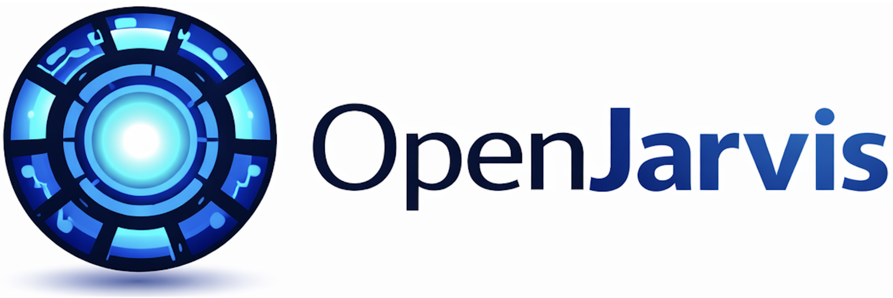

<div align="center">
  

  <p><i>Personal AI, On Personal Devices.</i></p>

  <p>
    <a href="https://github.com/adiisinghh/jarvis"></a>
    
    
  </p>
</div>

---

> **[Documentation](https://github.com/adiisinghh/jarvis/tree/main/docs)**
>
> **[Roadmap](https://github.com/adiisinghh/jarvis/blob/main/docs/development/roadmap.md)**
>
> **[Leaderboard](https://github.com/adiisinghh/jarvis/blob/main/docs/leaderboard.md)**

## Why Jarvis?

Personal AI agents usually route intelligence through cloud APIs, so the "personal" assistant still depends on someone else's server. Local models are now capable enough to handle most everyday chat and reasoning tasks — what has been missing is a software stack that makes local-first personal AI practical.

Jarvis is that stack. It provides shared primitives for building on-device agents, evaluations that treat energy, FLOPs, latency, and cost as first-class constraints alongside accuracy, and a learning loop that improves models from local trace data. Run locally by default and call the cloud only when you actually need to.

## Installation

Pick your platform and run one command. Each installer handles [uv](https://docs.astral.sh/uv/), the Python venv, Ollama, and a starter model — about 3 minutes on broadband.

| Platform | One-liner |
|---|---|
| **macOS · Linux · WSL2** | `curl -fsSL https://raw.githubusercontent.com/adiisinghh/jarvis/main/scripts/install/install.sh \| bash` |
| **Native Windows** | `irm https://raw.githubusercontent.com/adiisinghh/jarvis/main/deploy/windows/install.ps1 \| iex` |
| **Desktop GUI** | Download `.exe` / `.dmg` / `.deb` / `.rpm` / `.AppImage` from the [latest release](https://github.com/adiisinghh/jarvis/releases/latest) |

Then `jarvis` to start. The Rust extension and larger models continue downloading in the background; `jarvis doctor` shows status.

Platform-specific notes (WSL2 setup, native-Windows scheduled-task service, desktop prerequisites, manual / contributor install): see the [installation docs](https://github.com/adiisinghh/jarvis/blob/main/docs/getting-started/install.md).

## Quick Start

```bash
jarvis                          # start chatting (default: chat-simple)
jarvis gui                      # start the graphical browser interface
jarvis tui                      # start the terminal UI (requires `make build-tui`)
jarvis init --preset <name> --force  # replace config with a starter preset
```

`jarvis gui` starts the local API server and frontend, then opens the graphical
chat interface in your default browser. It requires Node.js 22+ and is
available from a source checkout; packaged desktop installers are available
from the [latest release](https://github.com/adiisinghh/jarvis/releases/latest).

> Prefix `jarvis ...` with `uv run`, or `source .venv/bin/activate` first.

| Preset | What it does |
|---|---|
| `morning-digest-mac` / `morning-digest-linux` / `morning-digest-minimal` | Spoken daily briefing from email, calendar, health, news |
| `deep-research` | Multi-hop research across indexed docs with citations |
| `code-assistant` | Agent with code execution, file I/O, and shell access |
| `scheduled-monitor` | Stateful agent on a schedule with memory |
| `chat-simple` | Lightweight conversation, no tools |

Example:

```bash
jarvis init --preset morning-digest-mac --force
jarvis connect gdrive          # one OAuth covers Gmail / Calendar / Tasks
jarvis digest --fresh          # generate and play your first briefing
```

Per-preset deep dives: [morning digest](https://github.com/adiisinghh/jarvis/blob/main/docs/user-guide/morning-digest.md) · [deep research](https://github.com/adiisinghh/jarvis/blob/main/docs/user-guide/deep-research.md) · [code assistant](https://github.com/adiisinghh/jarvis/blob/main/docs/user-guide/code-assistant.md) · [scheduled monitor](https://github.com/adiisinghh/jarvis/blob/main/docs/user-guide/scheduled-monitor.md) · [chat simple](https://github.com/adiisinghh/jarvis/blob/main/docs/user-guide/chat-simple.md) · or the full [quickstart guide](https://github.com/adiisinghh/jarvis/blob/main/docs/getting-started/quickstart.md).

## Providers

Jarvis separates **model identity** (`[intelligence]`) from **inference engines** (`[engine]`). An engine is a registered backend that runs or proxies a model; the cloud engine uses the `provider` hint to decide which vendor API to call.

### Built-in engines

| Engine key | Backend |
|---|---|
| `ollama` | Local Ollama daemon |
| `vllm`, `sglang`, `llamacpp`, `mlx`, `lmstudio`, `exo`, `nexa`, `uzu`, `apple_fm`, `lemonade` | OpenAI-compatible local servers |
| `gemma_cpp`, `afm` | On-device Gemma and Apple Foundation Models |
| `litellm` | LiteLLM SDK / proxy |
| `nim` | NVIDIA NIM |
| `cloud` | Hosted provider APIs (see below) |
| `multi` | Route across several engines |

### Cloud providers

Set `[intelligence] provider` to `local`, `openai`, `anthropic`, `google`, or `minimax`, and supply the matching API key:

| Provider | Environment variable |
|---|---|
| OpenAI | `OPENAI_API_KEY` |
| Anthropic | `ANTHROPIC_API_KEY` |
| Google Gemini | `GEMINI_API_KEY` |
| MiniMax | `MINIMAX_API_KEY` |
| DeepSeek | `DEEPSEEK_API_KEY` |
| OpenRouter | `OPENROUTER_API_KEY` |
| AtlasCloud | `ATLASCLOUD_API_KEY` |

Aggregator model IDs use `<aggregator>/<provider>/<model>` — for example `openrouter/anthropic/claude-sonnet-4.5`.

Choose an engine and model with `jarvis ask -e <engine> -m <model>`, or set `[engine] default` / `[intelligence] preferred_engine` in `config.toml`.

To add a provider, subclass `InferenceEngine` under `src/jarvis/engine/`, register it with `@EngineRegistry.register("key")`, export it from `src/jarvis/engine/__init__.py`, and add its config section in `src/jarvis/core/config.py`.

### Skills

Skills teach agents how to better use tools and improve their reasoning. Every skill is a tool — agents discover them from a catalog and invoke them on demand.

```bash
# Install skills from public sources
jarvis skill install hermes:arxiv
jarvis skill sync hermes --category research

# Use skills with any agent
jarvis ask "Use the code-explainer skill to explain this Python code: for i in range(5): print(i*2)"

# Optimize skills from your trace history
jarvis optimize skills --policy dspy

# Benchmark the impact
jarvis bench skills --max-samples 5 --seeds 42
```

Import from [Hermes Agent](https://github.com/NousResearch/hermes-agent), [OpenClaw](https://github.com/openclaw/skills), or any GitHub repo. Skills follow the [agentskills.io](https://agentskills.io/specification) open standard.

See the [Skills User Guide](https://github.com/adiisinghh/jarvis/blob/main/docs/user-guide/skills.md) and [Skills Tutorial](https://github.com/adiisinghh/jarvis/blob/main/docs/tutorials/skills-workflow.md) for details.

### Built-in Agents

Jarvis ships with eight built-in agents across three execution modes (on-demand, scheduled, continuous):

| Agent | Type | What it does |
|-------|------|-------------|
| `morning_digest` | Scheduled | Daily briefing from email, calendar, health, news — with TTS audio |
| `deep_research` | On-demand | Multi-hop research with citations across web and local docs |
| `monitor_operative` | Continuous | Long-horizon monitoring with memory, compression, and retrieval |
| `orchestrator` | On-demand | Multi-turn reasoning with automatic tool selection |
| `native_react` | On-demand | ReAct (Thought-Action-Observation) loop agent |
| `operative` | Continuous | Persistent autonomous agent with state management |
| `native_openhands` | On-demand | CodeAct — generates and executes Python code |
| `simple` | On-demand | Single-turn chat, no tools |

See the [User Guide](https://github.com/adiisinghh/jarvis/blob/main/docs/user-guide/morning-digest.md) and [Tutorials](https://github.com/adiisinghh/jarvis/blob/main/docs/tutorials/index.md) for detailed setup instructions.

Full documentation — including Docker deployment, cloud engines, development setup, and tutorials — lives in the [docs directory](https://github.com/adiisinghh/jarvis/tree/main/docs).

## Community

- **GitHub:** [github.com/adiisinghh/jarvis](https://github.com/adiisinghh/jarvis)
- **Docs:** [project documentation](https://github.com/adiisinghh/jarvis/tree/main/docs)

## Contributing

Contributions are welcome. See the [Contributing Guide](CONTRIBUTING.md) for contribution types and the PR process.

Quick start for contributors:

```bash
git clone https://github.com/adiisinghh/jarvis.git
cd jarvis
uv sync --extra dev
uv run pre-commit install
uv run pytest tests/ -v
```

Browse the [Roadmap](https://github.com/adiisinghh/jarvis/blob/main/docs/development/roadmap.md) for areas where help is needed.

## About

Jarvis is a local-first personal AI framework: a Python runtime for agents, tools, skills, evaluations, and learning, with a web GUI and desktop app on top. Models run on your own hardware by default, with cloud providers available when you opt in.

## License

[Apache 2.0](LICENSE)
